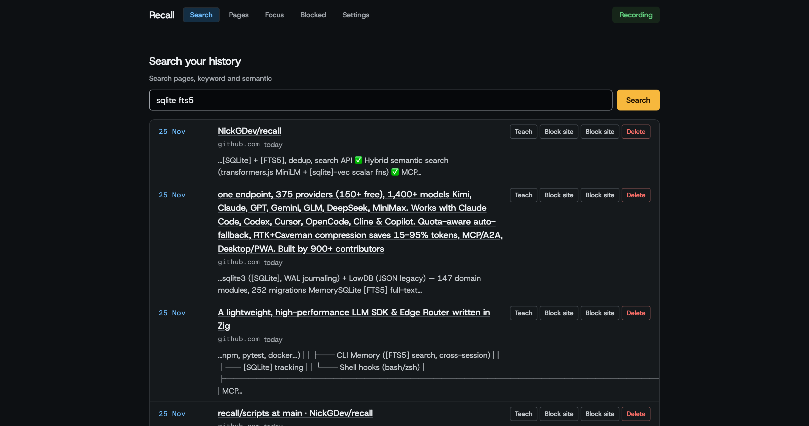
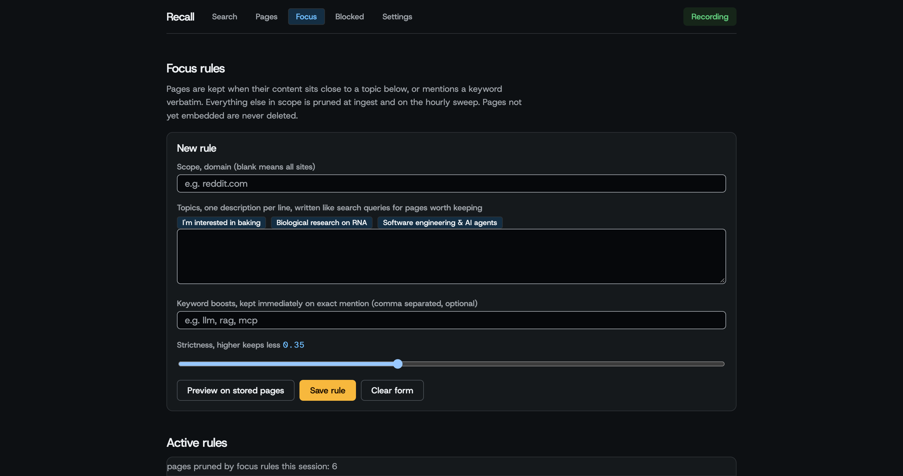

<p align="center">
  
</p>

<p align="center">
  <a href="https://github.com/NickGDev/iRecall/releases"></a>
  <a href="LICENSE"></a>
  
  
</p>

**Your browser remembers every tab you opened. iRecall remembers what you
actually *read* — privately, on your Mac, in clean full text your agents can
search.**

It's a Chrome extension + a little local server. While you browse, it keeps
structured copies of pages worth keeping, filters out the junk with a small
on-device model, embeds everything locally, and answers "what was that article
about SQLite tuning I read last month?" — from a dashboard or straight from
Claude via MCP.

## ✨ What it does

- 📖 **Captures what you read, not screenshots** — clean article text extracted
  at the DOM layer (Readability on a cloned DOM). Never captures password
  fields, incognito, or blocked domains (banking starts blocked).
- 🎯 **Learns your taste** — *focus rules* in plain language: "software
  engineering", "I'm interested in baking", "MCP servers". A small local model
  drops obvious noise *before* it ever hits the database.
- 🔍 **Finds by meaning, not just words** — hybrid search: SQLite FTS5 keyword
  ranking fused with local semantic embeddings. Every hit knows how old it is
  (`ageDays`, `stale`, `supersededBy`) so nothing quietly misleads you.
- 🤖 **Speaks MCP** — ships an MCP server so Claude (or any MCP client) gets
  `search_history`, `get_page`, and `recent_history` as tools.
- 🔒 **Local or nothing** — server binds `127.0.0.1` only, data lives in
  SQLite on your disk, models run in-process (ONNX). No accounts, no cloud
  APIs, no telemetry.

## 📸 Screenshots

| Search (hybrid, keyword + semantic) | Focus rules (plain language) |
|---|---|
|  |  |

## 🚀 Try it

**From a release** (macOS arm64/x64, Linux x64/arm64, Windows x64 — no
toolchain needed):

1. Grab your platform's bundle (`iRecall-app-macos-arm64.zip`,
   `iRecall-app-macos-x64.zip`, `*.deb` / `*.AppImage`, or the Windows
   `*-setup.exe`) from the
   [latest release](https://github.com/NickGDev/iRecall/releases), unzip, drag
   `iRecall.app` into Applications.
2. Right-click → **Open** once (it's unsigned; Gatekeeper asks, you're the
   Gatekeeper). Everything is inside the bundle: node runtime, models,
   extension, menu-bar tray.
3. Load the extension: `chrome://extensions` → Developer mode → **Load
   unpacked** → `iRecall.app/Contents/Resources/binaries/extension`.

That's it — an **iR** glyph appears in your menu bar; open it for live
status. Read stuff,
then open <http://127.0.0.1:8787> and search your brain. Data lives in
`~/Library/Application Support/iRecall/` and survives app replacement.
Start-at-login: System Settings → General → Login Items → add iRecall.

**From source** (dev / CRX force-install flow):

```bash
./scripts/install-mac.sh
```

Asks for your admin password once — the extension force-installs via Chrome's
`ExtensionInstallForcelist` policy (quit + reopen Chrome after). The installer
also sets up LaunchAgents (server + tray auto-start at login, auto-restart on
crash) and caches models under `server/models` — fully offline after install.

<details>
<summary><strong>🛠️ What the source install sets up</strong></summary>

- **Server** as LaunchAgent `dev.irecall.server` — auto-start at login,
  auto-restart on crash, logs to `server/server.log`
- **Models** under `server/models`:
  - `granite-embedding-small-english-r2` (IBM, 47M params, 384-dim) — search
    + focus-rule embeddings
  - `julia-1.5` (SupersonicLabs, 144M decision model) — early keep/drop gate,
    ~10–75 ms per page on CPU. ONNX exported locally via
    `scripts/julia15-export/`. Tune with `JULIA_THRESHOLD` (default 0.5),
    disable with `JULIA_DISABLE=1` (fail-open)
- **Extension** signed as CRX3 with a locally generated key (`keys/irecall-key.pem`,
  stable ID `cafcekahohdjjdgongnpbbigkgccokec`), served from
  `http://127.0.0.1:8787/updates.xml`; it fetches its auth token from
  `/bootstrap` — no manual paste
- **iRecall.app** tray (Rust/Tauri, menu-bar accessory app): template `iR`
  monogram icon. Menu: status, Open Dashboard,
  Pause/Resume, Quit. LaunchAgent `dev.irecall.tray`. The recording flag lives
  on the server (`/config`) — tray, dashboard, and popup all write there; the
  extension mirrors it within ~60s

Repack after extension changes: `npm run build:ext && npm run pack:ext` (bump
`version` in `manifest.json` so Chrome auto-updates the force-installed copy).

Verify everything:

```bash
npm run selfcheck    # 15 assertions: dedup, FTS, semantic, temporal, deletes
curl 127.0.0.1:8787/health
```

</details>

## 🎓 Teach it what to remember

On the **Focus** page, describe what you care about like search queries —
"software engineering", "LLMs and prompting", "self-hosting". Two-tier
filtering: keywords from your rule keep pages instantly; everything else gets
judged by the Julia decision model, and survivors are compared semantically
against the rule at embed time (per-rule strictness slider). The rules page
previews exactly what *would* be pruned — with similarity scores — before you
save, and rules can be edited, disabled, or deleted anytime. Pages not yet
embedded are never deleted.

Bonus: the server tracks per-domain keep/reject stats and feeds them back to
the extension, which stops capturing dead-cold domains at the source. A single
keep permanently protects that domain.

## 💬 Ask your agent

iRecall ships an MCP server (stdio) that wraps the local HTTP API:

```bash
# Claude Code, from the repo root
claude mcp add irecall -- node "$PWD/node_modules/tsx/dist/cli.mjs" "$PWD/mcp/src/main.ts"
```

| Tool | What your agent gets |
|---|---|
| `search_history(q, domain?, since?, until?, limit?)` | hybrid search with staleness flags |
| `get_page(id)` | full page text (truncated at 20k chars to protect context) |
| `recent_history(hours?)` | newest captures in a window |

Then just ask Claude: *"find that HN thread about sqlite-vec I read last week"*
or *"summarize everything I've read about MCP servers, newest first"*.

## 🕶️ Privacy, honestly

- **All local.** Server binds `127.0.0.1` only; DB at `server/data/irecall.db`
  (mode 600; FileVault protects at rest). A Host-allowlist middleware rejects
  non-loopback Host headers, closing DNS rebinding.
- **Auth:** bearer token gates `/ingest`, `/search`, `/recent`, `/pages/:id`,
  `/stats`. Open routes: `/health`, `/bootstrap`, `/`, `/updates.xml`,
  `/irecall.crx` (Chrome's updater needs those). The token defends against
  *web pages*, not local processes — same machine = trusted.
- **Never captured:** pages with password fields, blocked domains, incognito,
  extracted text under 250 chars.
- **Pause is real:** enforced at the server sink (`recording_off_at` — pages
  captured before a pause lands are dropped, pre-pause buffers still arrive).
  Popup shows it instantly; the server is the source of truth.
- **Agent content is untrusted:** captured pages are third-party web text, and
  pages can contain instructions aimed at agents. The MCP labels page content
  as untrusted data — don't pair iRecall reads with write-capable tools
  (shell, email, filesystem, or iRecall's own `teach_page`) without
  confirming each action.
- **Delete everything:** per-page, per-domain, and time-window wipes
  (24h/7d/30d/all), plus a retention dropdown that auto-purges hourly.
- **Force-install caveat:** Chrome won't let you remove a policy-installed
  extension from `chrome://extensions` (that's the point). Remove via
  `defaults delete com.google.Chrome ExtensionInstallForcelist` + Chrome
  restart. The installer merges into any existing forcelist, never replaces.

<details>
<summary><strong>🧱 Architecture</strong></summary>

```
Chrome ext (MV3, force-installed)   Local server (127.0.0.1:8787, LaunchAgent)
├─ spy.js (MAIN world)              ├─ open: /health /bootstrap / (status page)
│   └─ history API hook (SPA nav)   │        /updates.xml /irecall.crx
├─ content.js (isolated)            ├─ auth: /ingest /search /recent /stats
│   ├─ gates: paused / blocked      ├─ SQLite (WAL) + FTS5 + page_vectors
│   │   domains, password fields    │   (brute-force cosine KNN over blobs —
│   ├─ Readability on DOM clone      │    vec0 vtable broken w/ this build)
│   └─ min 250 chars else skip      ├─ hybrid search: bm25 + cosine KNN,
├─ background.js (service worker)   │   reciprocal rank fusion
│   ├─ /bootstrap token pre-wiring  ├─ embeddings: transformers.js (ONNX),
│   ├─ buffers in storage.session   │   granite-small r2 in-process, 384-dim
│   ├─ /api/filterlist 1-min sync   │   normalized; Julia early gate (ORT)
│   └─ flush at batch≥5 or 30s      └─ token auth (server/.token)
└─ popup: pause, activity log, stats
```

</details>

<details>
<summary><strong>🗺️ Roadmap</strong></summary>

1. ✅ Extension capture (Readability + gates + SPA nav)
2. ✅ Server: SQLite + FTS5, dedup, search API
3. ✅ Hybrid semantic search (transformers.js + sqlite-vec scalar fns)
4. ✅ MCP server (`mcp/`): search_history, get_page, recent_history (stdio)
5. ✅ Privacy UX: dashboard search + per-page/domain/age deletes, retention
   purge, time-window wipes
6. Enrichment worker (summaries, tags, sensitive-content classification —
   idle-time, async); PDF path (byte extraction, OCR fallback for scans) —
   no continuous OCR, ever.
7. Deferred: `sqliteai/sqlite-vector` SIMD scan swap — revisit at >50k
   vectors or when search latency bites (scalar-fn leg fine at personal scale).

</details>

<details>
<summary><strong>📦 How releases are built</strong></summary>

Artifacts never live in git (`server/models/`, built CRX, compiled dist are
ignored). Models are a manual job (Actions → **models** → Run workflow, then
upload `irecall-models.tar.gz` to the latest release) — tag-triggered model
downloads get auto-cancelled by GitHub's abuse detection on this repo.
Pushing a `v*` tag runs the release workflow:

- **build** — 5-target matrix (macOS arm64/x64, Linux x64/arm64, Windows x64):
  fetches the model bundle from the previous latest release, compiles the Rust
  tray (`src-tauri`) + server + extension, and assembles a self-contained
  bundle (bundled node runtime, tray, prod `node_modules`, models, unpacked
  extension). Unsigned — macOS users right-click-open once.
- **release** — attaches the per-platform bundles + `irecall-models.tar.gz`
  (re-attached each release so the chain propagates) + SHA256SUMS.

No keys are stored in the repo or CI; the CRX key is generated on your machine
(`npm run pack:ext` creates `keys/irecall-key.pem` on first use) for the
pinned-ID CRX.

</details>

## License

[MIT](LICENSE) — do whatever, attribution appreciated.
